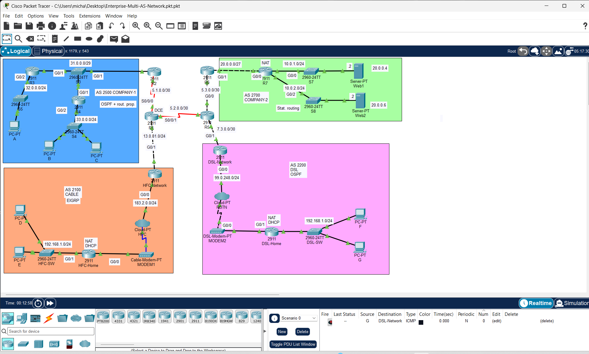

# Enterprise Multi-AS Network Design

## Overview

This project was developed as part of my networking studies at EC Utbildning using Cisco Packet Tracer.

The project focuses on designing, configuring and testing a multi-autonomous system enterprise network consisting of four autonomous systems.

**Project Status:** Completed – Passed  
**Institution:** EC Utbildning  
**Tool:** Cisco Packet Tracer

## Network Topology

## Network Topology

The diagram below shows the overall network architecture,
including the four autonomous systems and their connections.

## Network Architecture

The network consists of four autonomous systems:

- **AS 2500 – Company-1:** OSPF
- **AS 2700 – Company-2:** Static Routing
- **AS 2100 – HFC:** EIGRP and Static Routing
- **AS 2200 – PSTN:** OSPF

BGP was configured to enable routing between the autonomous systems, including route redistribution between BGP and internal routing protocols.

## Technologies Used

- BGP (Border Gateway Protocol)
- OSPF (Open Shortest Path First)
- EIGRP (Enhanced Interior Gateway Routing Protocol)
- Static Routing
- Static NAT and Dynamic NAT
- DHCP
- Standard ACL and Extended ACL
- Cisco IOS CLI
- Network Troubleshooting

## NAT Configuration

Static NAT was configured to map internal server addresses to public IP addresses.

Four static NAT mappings were configured and verified on router R7.

## Testing and Verification

Connectivity was tested using ping between PCs and servers across the network, including the public NAT addresses.

NAT configuration was examined using Cisco IOS commands:

- `show ip nat translations`
- `show ip nat statistics`
- `show running-config`

## Troubleshooting

During the project, network connectivity, IP addressing, DHCP, routing and NAT configurations were investigated and tested using Cisco Packet Tracer Simulation Mode and Cisco IOS commands.

## Tools

- Cisco Packet Tracer
- Cisco IOS Command Line Interface

## Project Files

- `Enterprise-Multi-AS-Network.pkt` – Cisco Packet Tracer project file.

## Learning Outcomes

This project provided practical experience in multi-AS network design, routing protocols, NAT configuration, network security and troubleshooting.

**Project type:** Educational Networking Project
